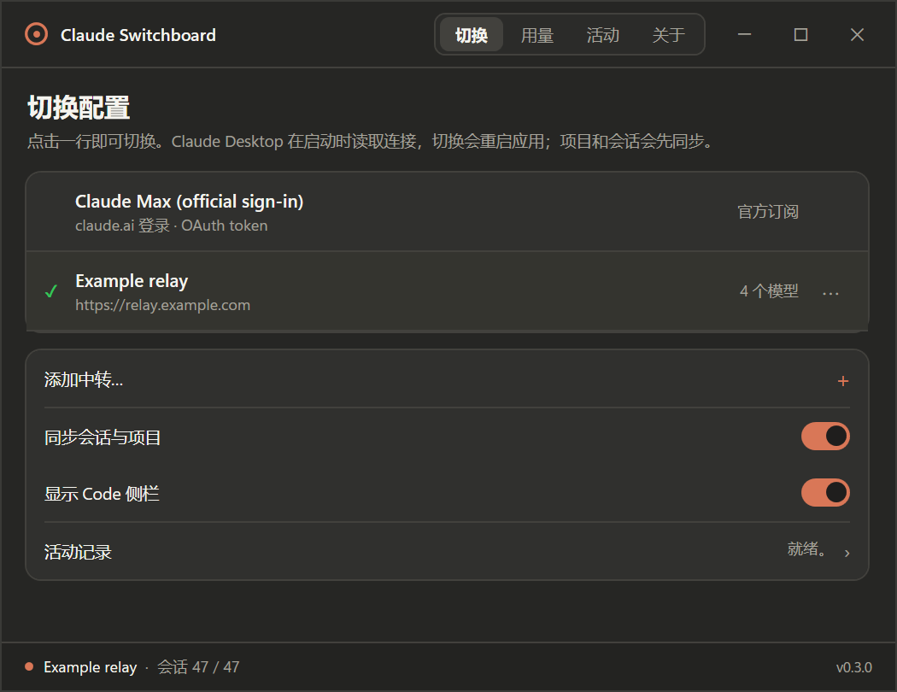

# Claude Switchboard


A Windows GUI for switching **Claude Desktop** between your **official Claude Max account** and **third-party Anthropic-compatible gateways**, with two-way session/project sync and a local usage dashboard.



## Why

Claude Desktop picks its inference connection **once at launch**. The app supports
`deploymentMode: "1p"` (claude.ai sign-in) and `"3p"` (third-party gateway), but it
has no built-in switcher, and each mode keeps its own session-card folder — so
switching normally makes your projects look empty. Claude Switchboard wraps the
supported mechanism into one window and copies the session cards across modes.

## Features

- **One-click switch** between the official account and any number of gateway profiles.
- **Tray-first**: the tray ring is green for the official account and orange for a
  gateway. Right-click for the profile list, add gateway, open panel and quit; closing
  the window keeps the app running in the tray.
- **Compact dark panel** with menu-style profile rows, an active check mark and
  Switch / Usage / Activity / About tabs.
- **Gateway profile manager**: name, base URL, API key, model list (id / label / tier / 1M).
- **API keys encrypted with Windows DPAPI** (per user), stored outside the repo.
- **Two-way session sync**: `claude-code-sessions/<account>/<org>/local_*.json` and
  `archived-sessions.idx`; the newer copy wins, so projects and history survive every switch.
- **Code sidebar mode**: sets `preferences.sidebarMode = "code"` so project groups render.
- **Local usage dashboard**: messages, input/output tokens, cache read/write and an
  estimated cost, grouped by model and by project, parsed from `~/.claude/projects`.
- **No telemetry, no network calls** except to the gateways you configure.

## Requirements

- Windows 10 or 11.
- Claude Desktop (Microsoft Store/MSIX build recommended; the standalone build works if the
  config directory layout is the same).
- PowerShell 7 (`pwsh`). Windows PowerShell 5.1 reads BOM-less UTF-8 scripts as ANSI and
  will fail on non-ASCII text.

## Install

```powershell
git clone https://github.com/Allenllii/claude-switchboard.git
cd claude-switchboard
pwsh -File .\ClaudeSwitchboard.ps1
```

Optional desktop shortcut:

```powershell
pwsh -File .\Install-Shortcut.ps1
```

## Add a gateway

Click **Add gateway…** and fill in:

| Field | Example |
|---|---|
| Name | `My relay · Sonnet 5.5` |
| Base URL | `https://relay.example.com` (the host that serves `/v1/messages`) |
| API key | `sk-…` (stored with DPAPI) |
| Models | one per line: `id \| label \| tier` |

Example model lines:

```
claude-opus-5-5 | Claude Opus 5.5 | opus
claude-sonnet-5-5 | Claude Sonnet 5.5 | sonnet
claude-haiku-5-5 | Claude Haiku 5.5 | haiku
claude-fable-5-2 | Claude Fable 5.2 | fable
```

`tier` is what Claude Code uses for its Opus/Sonnet/Haiku slots (optional).

**1M variants are off by default**, so the model picker shows one entry per model.
Append a fourth field only if the gateway really serves a 1M-context variant and you
want the extra entry:

```
claude-opus-5-5 | Claude Opus 5.5 | opus | 1m
```

## How it works

| What | Where |
|---|---|
| Deployment mode | `deploymentMode` in `claude_desktop_config.json` (`1p` / `3p`) |
| Gateway profile | `Claude-3p\configLibrary\<id>.json` + `_meta.json` (`appliedId`) |
| Session cards | `%APPDATA%\Claude\claude-code-sessions\<acct>\<org>` and `%LOCALAPPDATA%\Claude-3p\claude-code-sessions\<acct>\<org>` |
| Transcripts (usage) | `%USERPROFILE%\.claude\projects\**\*.jsonl` |
| Switchboard data | `%LOCALAPPDATA%\ClaudeSwitchboard\profiles.json` |

Two details matter:

1. **Order**: stop Claude → sync sessions → write config → start Claude. The app writes
   its own settings on exit, so writing before the process is gone gets overwritten.
2. **Encoding**: config JSON must be UTF-8 **without BOM**. A BOM makes the app ignore
   the file and silently keep the previous mode.

## Privacy

Everything stays on this machine. Gateway profiles, including the DPAPI-encrypted API
key, live in `%LOCALAPPDATA%\ClaudeSwitchboard\profiles.json` — outside the repository.
That file, logs and scan output are excluded by `.gitignore` in case a copy lands in the
project folder. Session cards and Claude Code transcripts are read locally; the app makes
no network calls except to the gateway you configure.

## Usage dashboard

The Usage tab reads local Claude Code transcripts. It shows totals for 7 or 30 days,
a per-model table and a per-project table. Costs are estimates from public list prices
(cache read at 0.1×, cache write at 1.25×/2× for 5-minute/1-hour TTL). It does not
contact Anthropic or any gateway, and it does not read your credentials.

## Limitations

- Switching restarts Claude Desktop (a few seconds). The app establishes its model
  client at launch, so an in-place switch is not possible.
- Closing the main window hides it to the tray. Use the tray menu or About → Quit to
  exit.
- One mode at a time. For simultaneous official + gateway windows, use the multi-window
  approach below.
- The mechanisms rely on undocumented file layouts; a Claude Desktop update may change
  them. The app fails loudly and the backup in `%LOCALAPPDATA%\ClaudeSwitchboard` can be
  restored.

## Related projects

- [cc-switch](https://github.com/farion1231/cc-switch) — multi-tool config switcher
  (Claude Code, Codex, …); Claude Desktop support is model-mapping only.
- [claude-desktop-multiple-windows-different-api](https://github.com/TonF1917/claude-desktop-multiple-windows-different-api) —
  isolated simultaneous windows for official + third-party APIs.
- [claude-account-switcher](https://github.com/SnlperStripes/claude-account-switcher) —
  tray account switcher that also copies session lists between accounts.
- [claude-desktop-shared-sessions](https://github.com/Tianqi-Bu/claude-desktop-shared-sessions) —
  hooks that keep the session list in sync across logins.

Claude Switchboard combines the switching idea with the session-copy approach; the 0.3
interface follows the tray-first, dark-dialog style of claude-account-switcher. It is not
affiliated with Anthropic.

## License

MIT
