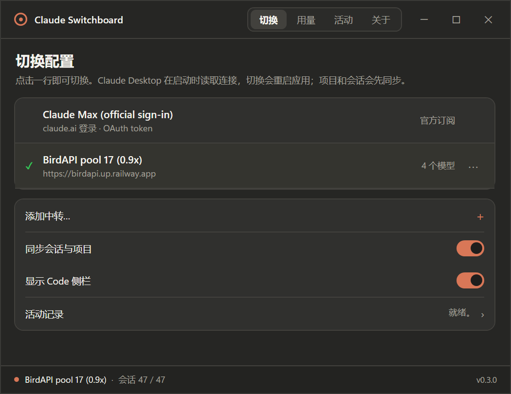

# Claude Switchboard（中文）

一个 Windows 图形工具：在 **Claude Desktop** 里一键切换「官方 Claude Max 账号」和「第三方 Anthropic 兼容网关」，切换时**双向同步会话与项目**，并带一个本地用量面板。



## 为什么需要

Claude Desktop 只在**启动时**读取一次推理连接：

- `deploymentMode = "1p"`：claude.ai 账号登录（官方订阅）
- `deploymentMode = "3p"`：第三方网关

官方没有提供切换器，而且两种模式各有一套会话卡片目录，直接切换后项目会“看起来空了”。本项目把官方支持的机制封装成一个窗口，并在切换时复制会话卡片。

## 功能

- 一键在官方账号与任意多个网关配置之间切换
- **托盘优先**：托盘圆环官方账号为绿色、中转为橙色；右键直接列配置、添加中转、打开面板或退出，关闭窗口后程序留在托盘
- **紧凑深色面板**：菜单式的配置行、当前项绿色对勾，切换 / 用量 / 活动 / 关于四个页签
- 网关配置管理：名称、Base URL、API Key、模型列表（id / 显示名 / 档位 / 1M）
- **API Key 用 Windows DPAPI 加密**，只存在用户目录，不进仓库
- **双向会话同步**：`claude-code-sessions/<账号>/<org>/local_*.json` 与 `archived-sessions.idx`，较新覆盖较旧
- 自动把 `preferences.sidebarMode` 设为 `code`，让项目分组显示
- **本地用量面板**：消息数、输入/输出、缓存读/写、估算费用，按模型和项目分组
- 无遥测；除你配置的网关外不发任何网络请求

## 环境要求

- Windows 10 / 11
- Claude Desktop（推荐 Microsoft Store/MSIX 版）
- PowerShell 7（`pwsh`）。Windows PowerShell 5.1 会把无 BOM 的 UTF-8 脚本按 GBK 读取，中文会乱码报错

## 安装

```powershell
git clone https://github.com/Allenllii/claude-switchboard.git
cd claude-switchboard
pwsh -File .\ClaudeSwitchboard.ps1
```

创建桌面快捷方式：

```powershell
pwsh -File .\Install-Shortcut.ps1
```

## 添加网关

点 **Add gateway…**，填写：

| 字段 | 示例 |
|---|---|
| Name | `我的中转 · Sonnet 5.5` |
| Base URL | `https://relay.example.com`（提供 `/v1/messages` 的地址） |
| API key | `sk-…`（DPAPI 加密保存） |
| Models | 每行一个：`id \| 显示名 \| 档位` |

模型行示例：

```
claude-opus-5-5 | Claude Opus 5.5 | opus
claude-sonnet-5-5 | Claude Sonnet 5.5 | sonnet
claude-haiku-5-5 | Claude Haiku 5.5 | haiku
claude-fable-5-2 | Claude Fable 5.2 | fable
```

`档位` 可选，对应 Claude Code 的 Opus/Sonnet/Haiku 槽位。

**1M 变体默认关闭**，模型菜单里每个型号只出现一次。只有当网关确实提供 1M 上下文、
并且你想要那个额外入口时，才加第四段 `| 1m`：

```
claude-opus-5-5 | Claude Opus 5.5 | opus | 1m
```

## 实现要点

| 内容 | 位置 |
|---|---|
| 部署模式 | `claude_desktop_config.json` 的 `deploymentMode`（`1p` / `3p`） |
| 网关配置 | `Claude-3p\configLibrary\<id>.json` + `_meta.json` 的 `appliedId` |
| 会话卡片 | `%APPDATA%\Claude\claude-code-sessions\...` 与 `%LOCALAPPDATA%\Claude-3p\claude-code-sessions\...` |
| 用量转录 | `%USERPROFILE%\.claude\projects\**\*.jsonl` |
| 本工具数据 | `%LOCALAPPDATA%\ClaudeSwitchboard\profiles.json` |

两个关键点：

1. **顺序**：退出 Claude → 同步会话 → 写配置 → 启动。应用退出时会回写自己的设置，先写后杀会被覆盖。
2. **编码**：配置 JSON 必须是 UTF-8 **无 BOM**；带 BOM 时应用解析失败并静默保持旧模式。

## 用量面板

读取本地 Claude Code 转录，展示 7/30 天的总量、按模型、按项目统计。费用按公开价格估算（缓存读 0.1×，缓存写 5 分钟 1.25×、1 小时 2×）。不联网、不读取凭据。

## 限制

- 切换会重启 Claude Desktop（几秒）；应用在启动时建立模型连接，无法原地切换。
- 关闭主窗口只是收进托盘。退出用托盘菜单，或「关于」页的「退出应用」。
- 同一时间只能一个模式。需要官方 + 网关**同时**开，请用
  [claude-desktop-multiple-windows-different-api](https://github.com/TonF1917/claude-desktop-multiple-windows-different-api)。
- 依赖未公开的文件布局，Claude Desktop 升级后可能失效；失败时会明确报错，配置有备份。

## 相关项目

- [cc-switch](https://github.com/farion1231/cc-switch)
- [claude-desktop-multiple-windows-different-api](https://github.com/TonF1917/claude-desktop-multiple-windows-different-api)
- [claude-account-switcher](https://github.com/SnlperStripes/claude-account-switcher)
- [claude-desktop-shared-sessions](https://github.com/Tianqi-Bu/claude-desktop-shared-sessions)

0.3 的界面参考了 [claude-account-switcher](https://github.com/SnlperStripes/claude-account-switcher)
的托盘与深色对话框风格。本项目与 Anthropic 无关联。

## 许可证

MIT
